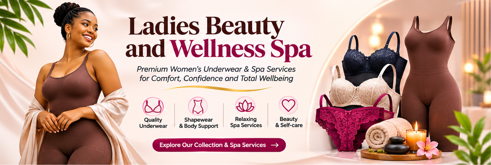

<p align="center">
  
</p>

<h1 align="center">Teemakeem Ladies World</h1>

<p align="center">
  <strong>A full-stack e-commerce &amp; beauty-spa booking platform built for a real Nigerian fashion and wellness business.</strong>
</p>

<p align="center">
  <a href="#tech-stack"></a>
  <a href="#tech-stack"></a>
  <a href="#tech-stack"></a>
  <a href="#tech-stack"></a>
  <a href="#tech-stack"></a>
  <a href="#tech-stack"></a>
  
</p>

---

## 🏪 About the Project

**Teemakeem Ladies World** is a production-grade, dual-category e-commerce platform serving a Nigerian fashion and wellness business. It ships two distinct storefronts under one codebase:

| Storefront | Description |
|---|---|
| 👗 **Ladies Wears & Underwear** | Modest fashion, intimates, loungewear, and accessories with full product variants (size, colour) |
| 💆 **Beauty & Wellness Spa** | Service booking for body massages, O-shot & repair, pedicure/manicure, waxing, dental, traditional Gyaran Jiki, and cosmetics |

Customers browse, add to cart, and check out entirely via **WhatsApp** — a pattern optimised for Nigerian mobile-first shopping habits.

---

## ✨ Feature Highlights

### 🛒 Storefront
- **Dual-category catalog** — completely separate UIs for fashion retail and spa services
- **Product variants** — size, colour, session type, home-vs-studio pricing
- **Persistent shopping cart** — session-backed, visible across all pages
- **WhatsApp checkout** — structured order messages auto-sent to the business line
- **Dark / light mode** — system preference detection with instant toggle, zero flash
- **Fully responsive** — mobile-first layouts with dedicated hero images for mobile/desktop

### 🔐 Admin Panel (`/admin`)
- Protected dashboard with order stats and product overview
- Full **CRUD** for products, categories, and variants with image upload
- **Live Settings page** — change logo, hero banners, contact info, social links, delivery text, about story, and admin credentials — all from the browser, no server access needed
- Toggle product availability and featured status in one click
- Order/enquiry management with status tracking

### ⚙️ Engineering
- **Laravel 11** — clean architecture with service classes (`CartService`, `WhatsAppService`)
- **Inertia.js** — SPA feel without a separate API; type-safe props shared from server to Vue
- **Vue 3 Composition API** + **TypeScript** throughout — strict typing, no `any`
- **Tailwind CSS v4** — utility-first, design-token–based, zero runtime CSS-in-JS
- **Vite 7** — sub-second HMR in dev, tree-shaken production bundles
- **Ziggy** — type-safe Laravel named routes available inside Vue components
- **SoftDeletes** on products — recoverable archive, not hard deletes
- **Settings model** — database-driven configuration with in-memory cache (`Cache::rememberForever`)
- SEO-ready — per-page `<title>` and `<meta description>` via Inertia head management

---

## 🖼️ Screenshots

> *Desktop homepage (light mode)*



> *Ladies Wears catalog*

> *Beauty & Wellness Spa catalog*

> *Admin dashboard*

---

## 🗂️ Project Structure

```
app/
├── Http/
│   ├── Controllers/
│   │   ├── Admin/          # Dashboard, Products, Categories, Settings, Orders
│   │   ├── CatalogController.php   # Clothing + Spa listing & detail
│   │   ├── CartController.php
│   │   ├── HomeController.php
│   │   └── PageController.php
│   └── Middleware/
├── Models/
│   ├── Setting.php         # Key-value store with cache helper
│   ├── Product.php         # SoftDeletes, variants, media
│   ├── Category.php
│   └── ...
├── Services/
│   ├── CartService.php     # Session cart logic
│   └── WhatsAppService.php # Order → WhatsApp message builder

resources/js/
├── Components/             # Navbar, Footer, ProductCard, ProductGallery, ThemeToggle
├── Layouts/                # AppLayout, AdminLayout
├── Pages/
│   ├── Home.vue            # Dual-hero homepage
│   ├── Clothing/           # Index + Show
│   ├── Confectionery/      # Spa Index + Show (rebranded)
│   ├── Cart/
│   ├── Admin/              # Dashboard, Products, Categories, Settings, Orders
│   └── ...
└── composables/
    └── useTheme.ts         # Dark mode persistence

database/seeders/
└── DatabaseSeeder.php      # Full realistic seed: 14 ladies wear + 10 spa products
```

---

## 🚀 Tech Stack

| Layer | Technology |
|---|---|
| Backend | PHP 8.2 · Laravel 11 · Eloquent ORM |
| Frontend | Vue 3 · TypeScript · Inertia.js v2 |
| Styling | Tailwind CSS v4 · Lucide Icons |
| Build | Vite 7 |
| Database | MySQL 8 |
| Auth | Laravel Breeze (custom admin guard) |
| Dev Server | XAMPP / `php artisan serve` |

---

## 🏁 Local Setup

```bash
# 1. Clone
git clone https://github.com/samoskillxteam/teamakeem.git
cd teamakeem

# 2. Install dependencies
composer install
npm install

# 3. Environment
cp .env.example .env
php artisan key:generate

# 4. Edit .env — set DB_DATABASE, DB_USERNAME, DB_PASSWORD

# 5. Migrate & seed
php artisan migrate --seed

# 6. Link storage
php artisan storage:link

# 7. Build frontend
npm run build

# 8. Serve
php artisan serve
```

Open [http://127.0.0.1:8000](http://127.0.0.1:8000)

**Admin login:**
- URL: `/admin/login`
- Email: `teemakeemladiesworld@gmail.com`
- Password: `password` *(change immediately via Settings)*

---

## 🔑 Key Design Decisions

### WhatsApp-First Checkout
Nigerian SME customers overwhelmingly prefer WhatsApp over payment gateway friction. The `WhatsAppService` builds a structured, human-readable order message with product names, variants, quantities, and totals, then opens `wa.me/` deep-link — no payment processor integration needed at MVP stage.

### Database-Driven Settings
Rather than environment variables scattered across `.env` and config files, every site setting (logo, hero images, contact info, social links, admin credentials) lives in a `settings` table and is served to the frontend via `getPublicSettings()`. The admin can update everything from `/admin/settings` without touching the server.

### Dual-Category Architecture
The same `Product` / `Category` / `ProductVariant` schema powers both a fashion retail store and a spa booking catalog. Category `slug` drives routing, filtering, and UI theming — zero code duplication.

### Inertia + TypeScript
Server-rendered HTML on first load (SEO + performance) + Vue SPA navigation thereafter. TypeScript interfaces mirror Laravel resource shapes, catching prop mismatches at compile time.

---

## 🌍 Business Context

Built for **Teemakeem Ladies World**, a real Kano- and Lagos-based business offering:
- Modest fashion & intimate ladies wear with nationwide delivery
- Professional beauty & wellness spa services including traditional Northern Nigerian *Gyaran Jiki* rituals
- Home service visits across Kano and Lagos

---

## 📄 License

MIT © [samoskillxteam](https://github.com/samoskillxteam)
